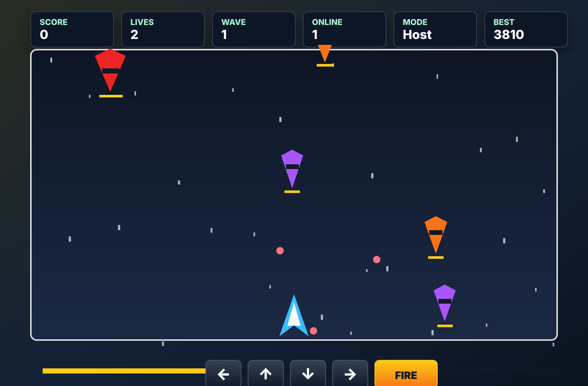

# HandwerkEbadi-project

Vue-3-Spielprojekt mit Vite. Das Spiel wird schrittweise vom Canvas-Grundlayout
zum Runner und danach zum LAN-faehigen Neon-Shooter aufgebaut.

## Spielvorschau



## Online-Demo

Nach dem Merge in `main` kann die statische Spiel-Demo ueber GitHub Pages
bereitgestellt werden:

```text
https://alireza-553.github.io/HandwerkEbadi-project/
```

Hinweis: GitHub Pages hostet nur die gebaute Demo. Der lokale LAN-Relay aus
Vite laeuft weiterhin ueber `npm run dev` im eigenen Netzwerk.

### Demo auf GitHub Pages starten

1. Pull Request mit der GitHub-Pages-Konfiguration in `main` mergen.
2. Im Repository **Settings > Pages** oeffnen.
3. Bei **Source** die Option **GitHub Actions** auswaehlen.
4. Im Repository den Tab **Actions** oeffnen.
5. Warten, bis der Workflow **Deploy GitHub Pages** erfolgreich abgeschlossen ist.
6. Danach die Demo im Browser oeffnen:

```text
https://alireza-553.github.io/HandwerkEbadi-project/
```

Wenn zuerst noch `404` angezeigt wird, kurz warten und die Seite danach neu
laden. GitHub Pages braucht nach dem ersten Deployment manchmal ein paar
Minuten.

## Lokaler Start

```bash
npm install
npm run dev
```

Danach im Browser die URL aus der Vite-Ausgabe oeffnen, meistens:

```text
http://localhost:5173
```

## LAN-Start

Damit andere Geraete im selben WLAN beitreten koennen, den Dev-Server mit
Host-Freigabe starten:

```bash
npm run dev -- --host 0.0.0.0 --port 5173
```

Dann auf dem zweiten Geraet die WLAN-IP des Host-Rechners oeffnen:

```text
http://<deine-wlan-ip>:5173
```

Beispiel:

```text
http://192.168.178.42:5173
```

## Steuerung

- Bewegung: `WASD` oder Pfeiltasten
- Schiessen / Start: Leertaste oder `FIRE`
- Mobile: Buttons unter dem Spielfeld

## Multiplayer-Test

1. Dev-Server mit `--host 0.0.0.0` starten.
2. Spiel auf dem Host-Rechner oeffnen.
3. Spiel auf einem zweiten Browser oder Geraet im selben WLAN oeffnen.
4. Pruefen, ob die Online-Anzeige steigt.
5. Beide Spieler bewegen und schiessen.
6. Pruefen, ob Remote-Spieler und Remote-Schuesse sichtbar sind.
7. Gegner/Waves vergleichen, wenn die Shared-World-Branches gemerged sind.

## Build

Vor jedem Pull Request einmal pruefen:

```bash
npm run build
```
